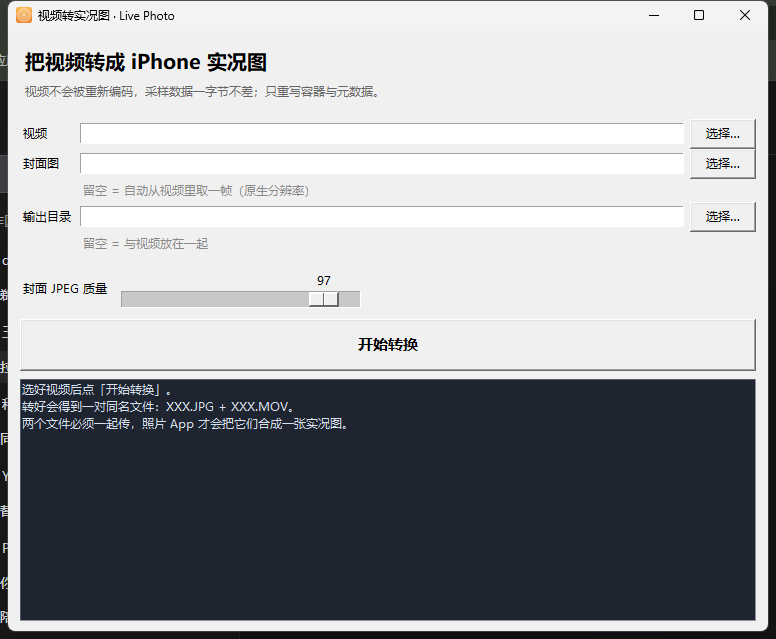

# Video2LivePhoto · 视频转 iPhone 实况图

[](LICENSE)
[]()
[]()
[](https://github.com/969246694/video2livephoto/releases)

把任意视频转成 iPhone 能识别的**实况图（Live Photo）**。
**视频不重新编码**——采样数据逐字节原样搬运，只重写容器和元数据，
每次转换后自动做逐样本比对自校验。



> 官网 / 下载：<https://yiyangzai.cn>

---


## 一、安装版（推荐）

安装包：`dist\视频转实况图-Setup.exe`（28 MB，**不需要装 Python**）

1. 双击 `视频转实况图-Setup.exe`
2. 选安装位置（默认 `%LOCALAPPDATA%\Programs\LivePhoto`，**不需要管理员权限**）
3. 勾选要不要建桌面/开始菜单快捷方式、「安装完成后立即打开」默认勾上
4. 点「开始安装」

装完直接打开的就是**图形界面**。以后从桌面快捷方式、开始菜单，或
`%LOCALAPPDATA%\Programs\LivePhoto\LivePhoto.exe` 打开，都是这个界面。

**卸载**：设置 → 应用 → 找到「视频转实况图」→ 卸载，
或直接运行 `LivePhoto.exe --uninstall`。
快捷方式、注册表项、程序目录都会清干净（已经转好的 JPG/MOV 不受影响）。

---

## 二、免安装版（绿色）

不想装，或者想改代码，直接用文件夹里这几个文件（需要 Python 3.7+ 和 Pillow）：

| 文件 | 用途 |
|---|---|
| `视频转实况图.bat` | 把视频拖到它图标上，松手即转 |
| `实况图转换-GUI.pyw` | 双击打开图形界面 |
| `livephoto.py` | 核心 / 命令行 |
| `update.py` | 版本检查（`livephoto.py check-update` 会用它）|

```bat
python livephoto.py 旅行.mp4
python livephoto.py 旅行.mp4 -o D:\实况图 -n IMG_0001
python livephoto.py 旅行.mp4 -c 封面.jpg          :: 用指定图片当封面
python livephoto.py 旅行.mp4 --uuid 1A2B...       :: 指定配对 ID
python livephoto.py info a.mp4 b.mov              :: 只看视频信息
```

---

## 三、转出来的东西

一对**同名文件**：

```
旅行.JPG   ← 封面，已写入 Apple MakerNote 0x0011
旅行.MOV   ← 视频，已写入 com.apple.quicktime.content.identifier
```

命令行会打印 **「无损校验: 通过」**，说明视频数据一个字节都没变。

### 传到 iPhone

**两个文件必须同名、一起传**，否则照片 App 认不出来：

* 隔空投送：同时选中两个文件一起发送
* iCloud 云盘 / 文件 App：放同一个文件夹一起导入
* ⚠️ 微信、QQ 会剥掉元数据，传过去就散了
* ⚠️ 分开传会变成「一张照片 + 一段视频」

---

## 四、无损到底无损在哪

| 环节 | 做法 | 是否有损 |
|---|---|---|
| 视频采样数据 | 整块搬运，一个字节不改 | **完全无损** |
| 容器 | MP4 → QuickTime MOV，重算 chunk 偏移 | 无损（只改索引） |
| 元数据 | 新增 moov/meta/keys/ilst | 无损 |
| 音频轨 | 原样保留 | 无损 |
| 封面帧 | 从视频解码一帧 → JPEG(q97, 4:4:4) | **这一处必然有损** |

封面必须重新编码：H.264 的帧是帧间压缩的，任何工具都无法直接抠出一张无损静帧。
想彻底避开，用 `-c 封面.jpg` 指定一张现成 JPEG——这时**连封面都是零重编码**
（EXIF 直接注入，压缩数据不动）。

### 每次都自校验
默认开启（`--no-verify` 可关）。转换后遍历源文件和输出文件的**每一张样本表**，
逐样本比对偏移和字节内容，全部一致才报「通过」；任何一处对不上就报错、不产出文件。

---

## 五、已知限制（重要）

1. **锁屏壁纸的动态效果做不到。**
   iPhone 相机拍的实况图里额外有两条 `mebx` 定时元数据轨（still-image-time +
   CoreMotion 运动数据），后者是陀螺仪采样，**无法凭空生成**。
   没有它，iOS 会显示「动态效果不可用」。
   → 本工具产出的是**标准实况图**：照片 App 能识别、能长按播放、能配对成一个资产，
   但设成锁屏壁纸时可能没有动态效果。

2. **建议 3 秒以内、H.264 编码。** 超长或 HEVC 一般仍能导入，
   但系统对壁纸有更严限制。工具遇到这两种情况会主动提示。

3. **不支持分片 MP4（fMP4）**，会明确报错。用
   `ffmpeg -i in.mp4 -c copy out.mp4` 转一下即可。

4. 视频超过 4 GiB 需要 co64，暂不支持（会报错而不是产出坏文件）。

---

## 六、在线更新

程序内置版本检测：**启动 2 秒后自动静默查一次**（查不到就跳过，不会弹错误烦你），
右下角也有「检查更新」按钮可以手动查。

**内置更新地址**：`https://yiyangzai.cn/livephoto/version.json`

发新版本时，只要改服务器上这个 `version.json`：

```json
{
  "version": "1.2.0",
  "url": "https://yiyangzai.cn/livephoto/视频转实况图-Setup.exe",
  "notes": "更新说明，会显示在提示框里",
  "mandatory": false
}
```

老用户下次打开程序就会看到「发现新版本」提示，点「是」直接用浏览器打开下载页。
**版本号必须比用户当前版本大**；按数字比较，所以 `1.10.0` 大于 `1.9.9`。

要上传的东西在 `dist\服务器文件\` 里，详细步骤见那份 `上传说明.txt`。

命令行也能查（绿色版）：

```bat
python livephoto.py check-update
python livephoto.py check-update --url https://别的地址/version.json
```

退出码：`0` = 已是最新，`1` = 有新版本，`2` = 检查失败。
临时换地址测试可以用环境变量 `LIVEPHOTO_UPDATE_URL`。

---

## 七、从源码重新构建

```bat
pip install pyinstaller pillow
python make_icon.py        :: 生成图标（可选，仓库里已有）
python build_all.py        :: 冻结程序 -> 打包负载 -> 生成 Setup.exe
```

产物在 `dist\`：`LivePhoto\`（免安装程序）+ `视频转实况图-Setup.exe`（安装包）。
中间文件全部收在 `build\` 里。

### 目录结构

```
livephoto.py             核心（CLI + 全部逻辑，纯标准库）
update.py                在线更新 / 版本检查
实况图转换-GUI.pyw        免安装版 GUI
视频转实况图.bat          免安装版拖放启动器（GBK 编码）
app/                     冻结用源码：gui.py / app_main.py / uninstall.py
installer/setup_main.py  安装程序
assets/app.ico           图标
build_all.py             一键构建
```

---

## 八、排错

**「抽帧失败」** → 用 `-c 封面.jpg` 自己指定一张封面。

**「缺少 Pillow」** → `pip install pillow`，或用 `-c` 指定现成 JPEG（不需要 Pillow）。

**导入后没变成实况图** → 检查两个文件是否同名、是否一起传的、配对 ID 是否一致：

```bat
python -c "import livephoto as lp;print(lp.read_apple_makernote(open('旅行.JPG','rb').read()))"
```

**杀毒软件报警** → PyInstaller 打包的程序偶尔会被误报，加信任即可；
也可以改用免安装版（源码跑，不会被误报）。

**改 .bat 后中文乱码** → 必须存成 **GBK** 编码，且**不能加 chcp 65001**：
中途切代码页会让 cmd 解析不了后面的中文行。